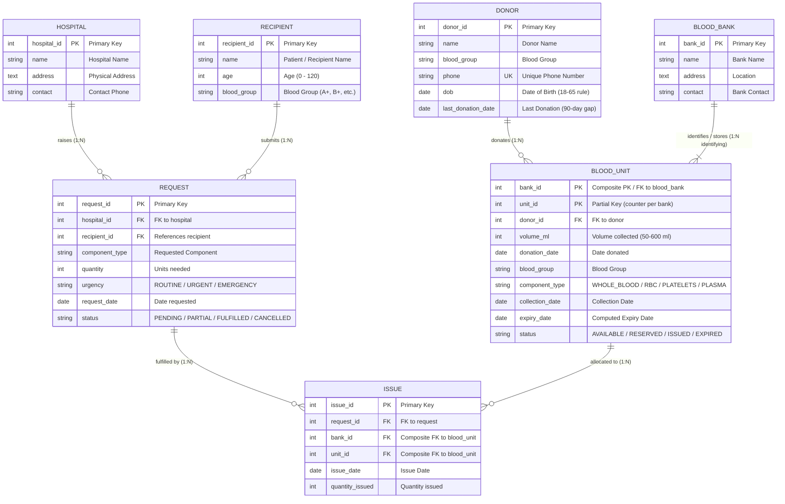

# 🩸 Blood Bank Management System — Person 1 (Om's Part)

## What is this project?

This is a **Blood Bank Management System** built as a DBMS course project by a team of 4 people. The system manages blood donors, donations, blood inventory, hospital requests, and blood issue tracking.

**My part (Person 1)** covers: **Donors, Donations, and the Database Foundation**.

---

## 📁 What did I build? (File-by-file explanation)

### 1. Database Foundation (everyone uses this)

| File | What it does |
|------|-------------|
| `docker-compose.yml` | Sets up MySQL 8.0 + backend + frontend as Docker containers. Think of it as a recipe that says "give me a MySQL server on port 3306, a Python API on port 8000, and a React app on port 5173" |
| `.env.example` | Template for secret configuration (DB password, ports). You copy this to `.env` and fill in your values |
| `.gitignore` | Tells Git which files to NOT track (like `node_modules/`, `.env`, `__pycache__/`) |
| `db/migrations/001_create_tables.sql` | **The most important file** — creates ALL 7 tables in MySQL. This is the DDL (Data Definition Language) from our ER diagram |
| `db/seed/seed_data.sql` | Fills the database with fake data for testing — 10 banks, 10 hospitals, 50 donors, 100 blood units, 20 recipients |

### 2. Backend Core (shared infrastructure)

| File | What it does |
|------|-------------|
| `backend/requirements.txt` | Lists all Python packages needed (FastAPI, SQLAlchemy, PyMySQL, etc.) |
| `backend/app/main.py` | **Entry point** — creates the FastAPI app, sets up CORS, registers all route handlers |
| `backend/app/core/config.py` | Loads settings from `.env` file using pydantic-settings. Builds the MySQL connection URL |
| `backend/app/core/database.py` | Creates the SQLAlchemy "engine" (connection to MySQL) and the `get_db()` function that FastAPI uses to inject DB sessions into routes |
| `backend/app/core/errors.py` | Custom error classes: `NotFound` (404), `ConflictError` (409), `ValidationFailed` (422) |
| `backend/app/core/enums.py` | Python enums that mirror MySQL ENUM columns (BloodGroup, ComponentType, UnitStatus, etc.) |

### 3. My Domain — Donors & Donations

| File | What it does |
|------|-------------|
| `backend/app/models/donor.py` | **ORM Model** — Python class that maps to the `donor` MySQL table. Each attribute = a column |
| `backend/app/models/blood_bank.py` | ORM model for `blood_bank` table (needed because donor → blood_unit → blood_bank) |
| `backend/app/models/blood_unit.py` | ORM model for `blood_unit` table (weak entity with composite PK) |
| `backend/app/schemas/donor.py` | **Pydantic schemas** — define the shape of data going IN (requests) and OUT (responses) of the API |
| `backend/app/repositories/donor_repo.py` | **Repository** — raw database queries (SELECT, INSERT, UPDATE, DELETE). No business logic |
| `backend/app/services/donor_service.py` | **Service** — business rules (eligibility check, CRUD with validation). Calls the repository |
| `backend/app/services/donation_service.py` | **Donation workflow** — the full process of recording a donation in one transaction |
| `backend/app/routers/donors.py` | **API routes** — maps HTTP endpoints (GET /donors, POST /donors, etc.) to service functions |
| `backend/app/routers/donations.py` | **API route** — POST /donations endpoint |

### 4. Frontend — Donor Pages

| File | What it does |
|------|-------------|
| `frontend/src/index.css` | Global CSS design system (dark theme, colors, buttons, tables, modals, animations) |
| `frontend/src/api/client.js` | JavaScript functions that call the backend API (fetch wrapper) |
| `frontend/src/App.jsx` | Main app component with sidebar navigation and React Router setup |
| `frontend/src/pages/donors/DonorList.jsx` | Donor list page — table with search, filter, add modal, delete |
| `frontend/src/pages/donors/DonorDetail.jsx` | Donor detail page — info card, eligibility, history, donate modal, edit modal |

### 5. Tests

| File | What it does |
|------|-------------|
| `backend/tests/test_donor.py` | Unit tests for eligibility edge cases, expiry computation, and schema validation |

---

## 🧠 Key Concepts Explained (for learning)

### What is an ORM? (Object-Relational Mapping)

Instead of writing raw SQL like:
```sql
SELECT * FROM donor WHERE donor_id = 5;
```

We write Python code:
```python
db.query(Donor).filter(Donor.donor_id == 5).first()
```

**SQLAlchemy** is the ORM we use. It translates Python objects ↔ database rows.

### What is the Model → Schema → Repository → Service → Router pattern?

This is called **layered architecture**. Each layer has ONE job:

```
Client (React) → Router → Service → Repository → Database (MySQL)
    ↑                                                    |
    └────────────── Response goes back ──────────────────┘
```

| Layer | Job | Example |
|-------|-----|---------|
| **Router** | Receive HTTP request, call service, return response | `@router.get("/donors/{id}")` |
| **Service** | Business rules (validation, eligibility check) | "Is this donor between 18-65 years old?" |
| **Repository** | Talk to the database (SQL queries via ORM) | `db.query(Donor).filter(...)` |
| **Model** | Define the table structure in Python | `class Donor(Base): donor_id = Column(Integer, ...)` |
| **Schema** | Define what data the API accepts/returns | `class DonorCreate(BaseModel): name, phone, ...` |

**Why separate them?**
- If you change the database, only the repository changes
- If you change a business rule, only the service changes
- If you change the API format, only the schema changes

### What is a Pydantic Schema?

Pydantic **validates** data automatically. If a client sends bad data, it catches it:

```python
class DonorCreate(BaseModel):
    name: str                    # must be a string
    phone: str = Field(min_length=10)  # must be at least 10 chars
    dob: date                    # must be a valid date

# If someone sends phone="abc" (too short), Pydantic rejects it with a 422 error
```

### What is a "Weak Entity" in DBMS?

`blood_unit` is a weak entity because its `unit_id` alone is NOT unique. It's only unique **within a specific blood bank**.

```
Bank 1 → Unit 1, Unit 2, Unit 3
Bank 2 → Unit 1, Unit 2, Unit 3  ← same unit_ids, different banks!
```

That's why the primary key is **composite**: `PRIMARY KEY (bank_id, unit_id)`.

### What is a Database Transaction?

When recording a donation, we need to:
1. Create a blood unit
2. Update the donor's `last_donation_date`

**Both must succeed or both must fail.** If step 2 fails, we should NOT have a blood unit without updating the donor.

```python
try:
    db.add(blood_unit)        # step 1
    donor.last_donation_date = today  # step 2
    db.commit()               # save BOTH changes
except:
    db.rollback()             # undo EVERYTHING
```

This is called a **transaction**. It follows the **ACID** properties (Atomicity, Consistency, Isolation, Durability).

### What is CORS?

CORS = Cross-Origin Resource Sharing. The React frontend runs on `localhost:5173` but the API runs on `localhost:8000`. By default, browsers block requests between different origins. CORS middleware tells the browser "yes, requests from port 5173 are allowed."

### What is the Eligibility Check?

Before a donor can donate, they must pass two rules:

1. **Age rule**: Must be 18-65 years old
   - We calculate age from `dob` (date of birth), not by storing age directly
   - Why? Because age changes every year, but dob never changes

2. **90-day gap rule**: Must wait at least 90 days between donations
   - We check `last_donation_date` and compute the gap
   - This protects donors from donating too frequently

### How does `unit_id` work? (Per-bank counter)

Since `blood_unit` is a weak entity, `unit_id` is a **partial key** — it's unique per bank, not globally.

```python
def _get_next_unit_id(db, bank_id):
    max_id = db.query(func.max(BloodUnit.unit_id))
                .filter(BloodUnit.bank_id == bank_id)
                .scalar()
    return (max_id or 0) + 1
```

So Bank 1 might have units 1,2,3,4,5... and Bank 2 also has units 1,2,3... independently.

### What is `Depends(get_db)` in FastAPI?

FastAPI uses **dependency injection**. Instead of manually creating a database connection in every route, we declare it as a dependency:

```python
@router.get("/donors")
def list_donors(db: Session = Depends(get_db)):  # FastAPI injects `db` automatically
    return donor_service.get_all_donors(db)
```

`get_db()` yields a session, the route uses it, and the session is automatically closed when the route finishes.

---

## 🏗️ How the MySQL Schema Differs from PostgreSQL

The original plan used PostgreSQL. Here's what I changed for MySQL:

| PostgreSQL | MySQL | Why |
|-----------|-------|-----|
| `SERIAL PRIMARY KEY` | `INT AUTO_INCREMENT PRIMARY KEY` | MySQL uses AUTO_INCREMENT instead of SERIAL |
| `CREATE TYPE ... AS ENUM` | Inline `ENUM(...)` in column definition | MySQL doesn't support standalone enum types |
| `DEFAULT CURRENT_DATE` | `DEFAULT (CURRENT_DATE)` | MySQL requires parentheses for function defaults |
| `psycopg2` driver | `PyMySQL` driver | Different database, different Python driver |
| `postgresql://` connection URL | `mysql+pymysql://` connection URL | SQLAlchemy uses different URL scheme |

---

## 🔌 My API Endpoints

| Method | Endpoint | What it does |
|--------|----------|-------------|
| `GET` | `/donors/` | List all donors (supports `?blood_group=A+&search=Om`) |
| `POST` | `/donors/` | Register a new donor |
| `GET` | `/donors/{id}` | Get one donor's details |
| `PUT` | `/donors/{id}` | Update a donor's info |
| `DELETE` | `/donors/{id}` | Delete a donor |
| `GET` | `/donors/{id}/eligibility` | Check if donor can donate right now |
| `GET` | `/donors/{id}/history` | Get all past donations |
| `POST` | `/donations/` | Record a new donation (creates blood unit + updates donor) |

### Example API calls (using curl):

```bash
# List all A+ donors
curl http://localhost:8000/donors/?blood_group=A%2B

# Register a new donor
curl -X POST http://localhost:8000/donors/ \
  -H "Content-Type: application/json" \
  -d '{"name": "Om Mahalle", "blood_group": "AB+", "phone": "9876543245", "dob": "2004-05-12"}'

# Check eligibility
curl http://localhost:8000/donors/1/eligibility

# Record a donation
curl -X POST http://localhost:8000/donations/ \
  -H "Content-Type: application/json" \
  -d '{"donor_id": 1, "bank_id": 1, "volume_ml": 450, "component_type": "WHOLE_BLOOD"}'
```

---

## 🚀 How to Run This Project

### Prerequisites
- Python 3.10+
- MySQL 8.0+ (or Docker)
- Node.js 18+

### Option 1: With Docker (easiest)

```bash
# 1. Copy the env file
cp .env.example .env

# 2. Start everything
docker-compose up -d

# 3. Run the migration and seed
docker exec -i bloodbank_mysql mysql -u root -pbloodbank123 < db/migrations/001_create_tables.sql
docker exec -i bloodbank_mysql mysql -u root -pbloodbank123 < db/seed/seed_data.sql
```

### Option 2: Without Docker (manual setup)

```bash
# 1. Set up MySQL
mysql -u root -p
# In MySQL:
#   CREATE DATABASE bloodbank;
#   source db/migrations/001_create_tables.sql;
#   source db/seed/seed_data.sql;

# 2. Copy and edit env file
cp .env.example .env
# Edit .env with your MySQL password

# 3. Set up Backend
cd backend
pip install -r requirements.txt
uvicorn app.main:app --reload
# API is now at http://localhost:8000

# 4. Set up Frontend (in a new terminal)
cd frontend
npm install
npm run dev
# UI is now at http://localhost:5173
```

### Running Tests

```bash
cd backend
pip install -r requirements.txt
python -m pytest tests/ -v
```

---

## 🔗 Integration Points (How my code connects to others)

### What I provide to other team members:

| Function | Used by | What it does |
|----------|---------|-------------|
| `donor_service.is_eligible(donor)` | My own tests | Returns `(bool, reason_string)` |
| `donor_service.get_donor(db, id)` | Person 2 (donation_service calls it) | Gets a donor or raises 404 |

### What I use from other team members:

| Function | Provided by | What it does |
|----------|------------|-------------|
| `unit_service.create_unit()` | Person 2 | Creates a blood unit — I have a local version for now |
| `core/errors.py` (NotFound, etc.) | Person 2 (officially) | Error classes — I created the initial version |

### How the donation workflow connects everything:

```
Person 1 (me)                    Person 2 (will replace)
┌──────────────────────┐        ┌──────────────────────┐
│ POST /donations/     │        │                      │
│   ↓                  │        │                      │
│ donation_service     │        │                      │
│   .record_donation() │        │                      │
│   ↓                  │        │                      │
│ Check donor exists   │        │                      │
│ Check eligibility    │        │                      │
│ Create blood unit ───┼───→    │ unit_service         │
│ Update last_donation │        │   .create_unit()     │
│ Commit transaction   │        │   (will replace my   │
│                      │        │    local version)    │
└──────────────────────┘        └──────────────────────┘
```

---

## 📊 Complete ER Diagram & Table Mapping

### Visual ER Diagram (Mermaid)



### ER Entities Breakdown & Schema Notes

| ER Entity | Entity Type | Primary Key (PK) | Foreign Keys (FK) | Notes & Constraints |
|-----------|-------------|------------------|-------------------|---------------------|
| **DONOR** | Strong | `donor_id` (Auto-increment) | None | `phone` is UNIQUE. Age checked via `dob` (18-65). `last_donation_date` for 90-day cooldown. |
| **BLOOD BANK** | Strong | `bank_id` (Auto-increment) | None | Physical blood bank facility. |
| **BLOOD UNIT** | **Weak Entity** | `(bank_id, unit_id)` Composite PK | `bank_id` → `blood_bank`, `donor_id` → `donor` | `unit_id` is a **partial key** (per-bank counter). Identified by `bank_id`. Volume between 50-600 ml. |
| **HOSPITAL** | Strong | `hospital_id` (Auto-increment) | None | Medical institution requesting blood. |
| **RECIPIENT** | Strong | `recipient_id` (Auto-increment) | None | Patient requiring blood. Age 0-120. |
| **REQUEST** | Strong | `request_id` (Auto-increment) | `hospital_id`, `recipient_id` | Raised by hospital for recipient. Status: PENDING / PARTIALLY_FULFILLED / FULFILLED / CANCELLED. |
| **ISSUE** | Associative / Linking | `issue_id` (Auto-increment) | `request_id`, `(bank_id, unit_id)` | Connects a specific REQUEST to the allocated BLOOD UNIT. |

### Relationships & Cardinalities:
1. **DONOR donates BLOOD_UNIT (1:N)**: A donor can donate multiple blood units over time. Each unit comes from exactly 1 donor.
2. **BLOOD_BANK stores / identifies BLOOD_UNIT (1:N identifying)**: A blood bank contains multiple units. A unit cannot exist without its bank (identifying relationship).
3. **HOSPITAL raises REQUEST (1:N)**: A hospital can raise multiple blood requests.
4. **RECIPIENT has REQUEST (1:N)**: A recipient patient can have multiple requests.
5. **REQUEST fulfilled by ISSUE (1:N)**: A request can be fulfilled by 1 or more unit issues (supporting partial fulfilment).
6. **BLOOD_UNIT allocated in ISSUE (1:N)**: A unit is linked to an issue record upon distribution.

---

## 📝 My Git Commits (what was pushed and why)

| # | Commit Message | What's in it |
|---|---------------|-------------|
| 1 | `feat: project foundation` | docker-compose, MySQL DDL, seed data, .env, .gitignore, requirements.txt |
| 2 | `feat: backend core, ORM models, schemas` | config, database session, errors, enums, Donor/BloodBank/BloodUnit models, Pydantic schemas |
| 3 | `feat: donor CRUD, eligibility, donation recording` | repo, services (eligibility + donation workflow), API routes, main.py |
| 4 | `feat: React frontend` | Full donor UI — list, detail, modals, dark theme CSS |
| 5 | `docs: tests + README` | Unit tests + this README |

---

## 🧪 What the Tests Cover

| Test | What it checks |
|------|---------------|
| `test_eligible_donor_no_previous_donation` | 25-year-old, never donated → eligible ✅ |
| `test_eligible_donor_with_old_donation` | Donated 100 days ago → eligible ✅ |
| `test_ineligible_too_young` | 16 years old → rejected ❌ |
| `test_ineligible_too_old` | 70 years old → rejected ❌ |
| `test_ineligible_recent_donation` | Donated 30 days ago → rejected ❌ |
| `test_edge_case_exactly_18` | Exactly 18 → eligible ✅ (boundary) |
| `test_edge_case_exactly_65` | Exactly 65 → eligible ✅ (boundary) |
| `test_edge_case_exactly_90_days` | Last donation exactly 90 days ago → eligible ✅ |
| `test_edge_case_89_days` | Last donation 89 days ago → rejected ❌ |
| `test_whole_blood_expiry` | Whole blood expires in 35 days |
| `test_platelet_expiry` | Platelets expire in 5 days |
| `test_plasma_expiry` | Plasma expires in 365 days |
| `test_valid_donor_create` | Valid data passes schema |
| `test_invalid_phone` | Bad phone number is rejected |
| `test_future_dob_rejected` | Future DOB is rejected |
| `test_donation_volume_bounds` | Volume must be 50-600 ml |

---

## 💡 Quick Reference: Technologies Used

| Technology | What it is | Why we use it |
|-----------|-----------|--------------|
| **MySQL 8.0** | Relational database | Stores all our data (tables, rows) |
| **FastAPI** | Python web framework | Creates the REST API (handles HTTP requests) |
| **SQLAlchemy** | ORM (Object-Relational Mapper) | Write Python instead of raw SQL |
| **PyMySQL** | MySQL driver for Python | Lets SQLAlchemy talk to MySQL |
| **Pydantic** | Data validation library | Validates request/response data |
| **React 18** | Frontend JavaScript library | Builds the user interface |
| **Vite** | Frontend build tool | Fast dev server with hot reload |
| **React Router** | Client-side routing | Navigate between pages without reload |
| **Docker Compose** | Container orchestration | Run MySQL + API + UI with one command |
| **pytest** | Python testing framework | Run automated tests |
